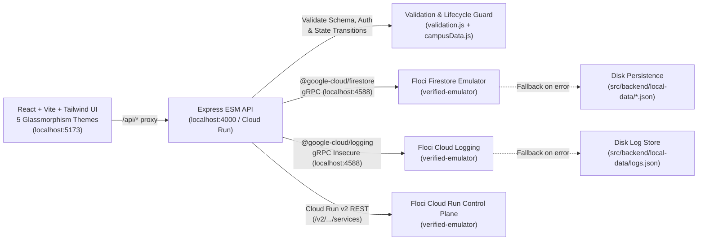
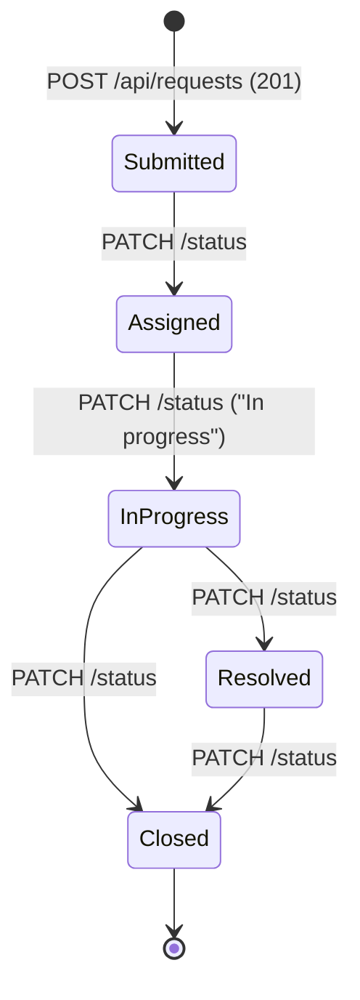

# CampusServe Architecture & Data Model

## System Architecture

---

## Integrated Platform Modules & Endpoints

| Module | Endpoints | Persistence Backend | Notes |
| :--- | :--- | :--- | :--- |
| **Service Requests & Lifecycle** | `POST /api/requests`, `GET /api/requests`, `GET /api/requests/:id`, `PATCH /api/requests/:id/status` | Floci Firestore (`serviceRequests`) | Generates `REQ-<16 hex>`, auto-attaches `assignedDepartment`, enforces strict transitions |
| **Synthetic Demo Auth** | `POST /api/auth/login`, `POST /api/auth/register` | Floci Firestore (`syntheticProfiles`) | Synthetic IDs only (`STU-XXXX`, `FAC-XXX`, `ADM-XXX`); login payloads never logged |
| **Campus Directory & Routing** | `GET /api/locations`, `inferDepartment()` | Static BMSCE Knowledge (`campusData.js`) | 24 classrooms/labs/libraries across 6 buildings mapped to 9 support sectors |
| **Analytics & Audit** | `GET /api/analytics`, `GET /api/audit` | Derived from Firestore (`serviceRequests`, `posts`) | Aggregated status/category/location/sector metrics + redacted state-transition trail |
| **Announcements, Posts & Decisions** | `GET/POST /api/announcements`, `GET/POST /api/posts`, `POST /api/posts/:id/vote` | Floci Firestore (`announcements`, `posts`) | Community feed, emoji reactions, upvotes, and SHA-256 receipt-backed anonymous voting |
| **Notifications & CampusBot** | `GET /api/notifications`, `POST /api/campusbot` | Floci Firestore + rule engine | Live status alerts and ticket lookup (`REQ-...`) / routing guidance |
| **Cloud Health & Redacted Logs** | `GET /api/health`, `GET /api/logs`, `POST /api/seed` | Floci Cloud Logging (`campusserve-api-audit`) + Cloud Run v2 | Strictly whitelisted 6-key structured logs (`buildSafeLogEntry`) |

---

## Request Lifecycle & Allowed Transition Matrix

| Current Status | Allowed Next States | Rejected Jumps (HTTP `400`) |
| :--- | :--- | :--- |
| `Submitted` | `Assigned` | `In progress`, `Resolved`, `Closed`, `Submitted` |
| `Assigned` | `In progress` | `Submitted`, `Resolved`, `Closed`, `Assigned` |
| `In progress` | `Resolved`, `Closed` | `Submitted`, `Assigned`, `In progress` |
| `Resolved` | `Closed` | `Submitted`, `Assigned`, `In progress`, `Resolved` |
| `Closed` | *(none — terminal)* | Any status |

Any invalid transition returns HTTP `400` with `{ error, requestId, currentStatus, requestedStatus, allowedNextStates }` and leaves the persisted Firestore document untouched.

---

## Data Dictionary (`serviceRequests` Collection)

| Field | Type | Constraints / Format | Privacy Classification |
| :--- | :--- | :--- | :--- |
| `requestId` | `string` | `^REQ-[a-f0-9]{16}$` (`crypto.randomBytes(8)`) | Non-PII operational identifier (logged) |
| `category` | `string` | Enum: `"Classroom Maintenance"`, `"IT Support"`, `"Facilities"` | Operational attribute (not logged) |
| `location` | `string` | Trimmed string, 3–80 chars | Campus location (stripped from logs) |
| `description` | `string` | Trimmed string, 10–500 chars | Free-text payload (strictly stripped from logs) |
| `requesterRef` | `string` | Regex `/^STU-\d{3,6}$/` (synthetic reference only) | Synthetic student ref (strictly stripped from logs) |
| `assignedDepartment` | `string` | Auto-routed from 9 BMSCE support sectors | Support team assignment |
| `status` | `string` | Initialized strictly to `"Submitted"` | Lifecycle state |
| `createdAt` | `string` | ISO-8601 UTC timestamp | Operational timestamp |
| `updatedAt` | `string` | ISO-8601 UTC timestamp | Operational timestamp |
| `statusHistory` | `array` | Array of `{ fromStatus, toStatus, changedBy, timestamp }` | Audit trail stored on document |

---

## Privacy-Safe Structured Log Schema (`campusserve-api-audit`)

Every logged event passes through `buildSafeLogEntry()` in `src/backend/adapters/loggingAdapter.js`, which constructs a new object containing **only** these 6 fields:

| Field | Type | Description |
| :--- | :--- | :--- |
| `timestamp` | `string` | ISO-8601 timestamp of the log event |
| `requestId` | `string \| null` | `REQ-...` ID if applicable, otherwise `null` |
| `operation` | `string` | `CREATE_REQUEST`, `GET_REQUEST`, `LIST_REQUESTS`, `UPDATE_STATUS`, `INVALID_INPUT`, `INVALID_TRANSITION` |
| `result` | `string` | Outcome label (e.g., `CREATED`, `FOUND`, `NOT_FOUND`, `VALIDATION_FAILED`, `TRANSITION_REJECTED`) |
| `statusCode` | `number` | HTTP status code (`200`, `201`, `400`, `404`, `500`) |
| `latencyMs` | `number` | Request processing latency in milliseconds |

`description`, `requesterRef`, `location`, login payloads, post bodies, chat text, HTTP headers, and secrets are never accepted into the log constructor.
